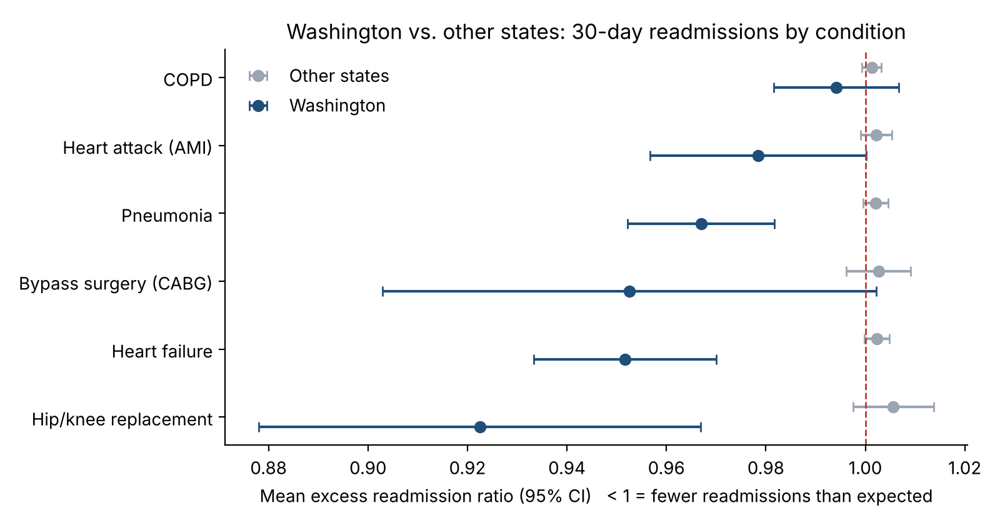

# Washington Hospital Readmissions: How Do WA Hospitals Compare?

An end-to-end analytics project using public CMS hospital quality data: API ingestion, SQL modeling, documented data validation, inferential statistics, and an interactive Tableau Public dashboard.

**Interactive dashboard:** [Tableau Public link — add after publishing](#)



## Questions

1. Do Washington hospitals have more or fewer 30-day readmissions than expected, compared with hospitals in other states, for each condition in the CMS Hospital Readmissions Reduction Program (HRRP)?
2. Which individual WA hospitals are statistically higher or lower than expected, once hospital volume is taken into account?
3. Which WA hospitals are not covered by HRRP at all (for example, Critical Access Hospitals), and what does that mean for how the statewide numbers should be read?
4. Is a hospital's CMS overall star rating related to its readmission performance?

## Key findings

Data: CMS HRRP, discharges July 2021 – June 2024 (pulled November 2026). 46 Washington hospitals in HRRP compared with about 2,600 hospitals in other states.

1. **Washington hospitals have fewer readmissions than expected on every condition, and the gap is statistically significant for three of them.** WA's mean excess readmission ratio (ERR) is below the national level for all six conditions. After correcting for multiple comparisons (Benjamini-Hochberg), the difference holds for **heart failure** (WA 0.952 vs. 1.002, adjusted p < 0.001), **pneumonia** (0.967 vs. 1.002, adjusted p < 0.001), and **hip/knee replacement** (0.923 vs. 1.006, adjusted p = 0.001). Effect sizes are moderate (Cohen's d −0.53 to −0.78). Heart attack and bypass surgery point the same way but fall just short of significance, and COPD is close to the national level.
2. **Most hospital-level variation is noise.** Of 139 WA hospital-condition pairs with reportable counts, 126 (91%) fall within what chance would produce. 11 are significantly lower than expected and 2 are significantly higher. Heart failure accounts for most of the lower-than-expected results, which matches the statewide finding.
3. **HRRP covers fewer than half of Washington's hospitals.** Only 46 of 101 WA hospitals are in the program. The 38 Critical Access Hospitals, along with psychiatric, children's, VA/DoD, and cancer hospitals, aren't measured. So statewide HRRP results describe larger acute care hospitals, not rural Washington.
4. **Higher star ratings go with lower readmissions** (Spearman ρ = −0.45 in WA, −0.44 nationally). This is partly built in, because readmissions are one component of the CMS star rating, so it shouldn't be read as independent confirmation.

### Data quality notes
- 222 HRRP rows (37 hospitals, none in WA) have no match in the current Hospital General Information file, most likely hospitals that closed or merged since the reporting period. They stay in the national comparison because their ERR values are valid.
- One ERR value (0.47, a CA hip/knee measure) is outside the expected range. It was checked and kept, since CMS publishes it as reported.
- 56% of rows nationally have suppressed readmission counts (fewer than 11), so hospital-level O/E flags only cover hospitals with enough volume.

## Pipeline

```
CMS Provider Data API ──► src/fetch_cms.py ──► data/raw/*.csv
                                                   │
                         src/build_db.py ◄─────────┘
                           ├─ validation checks ──► data/processed/data_quality_report.md
                           ├─ SQLite load + sql/01_views.sql
                           └─ Tableau extracts ───► data/processed/*.csv
                                                   │
                         src/analysis.py ◄─────────┘
                           ├─ WA vs. US tests ────► wa_vs_us_tests.csv
                           ├─ hospital O/E flags ─► wa_hospital_oe_flags.csv
                           ├─ funnel limits ──────► funnel_limits.csv
                           └─ figures/*.png
```

| Step | What it does |
|---|---|
| **Ingest** (`fetch_cms.py`) | Pages through the CMS Provider Data Catalog datastore API for Hospital General Information (`xubh-q36u`) and HRRP (`9n3s-kdb3`), verifies the row count against the API's reported total, and writes a fetch log. |
| **Validate** (`build_db.py`) | Runs documented integrity checks: unique keys, one row per hospital and measure, known measure codes, join coverage, ERR = predicted ÷ expected, plausible ranges, suppressed values, and a single reporting period. Results go to `data_quality_report.md`. |
| **Model** (`sql/01_views.sql`) | Joins hospitals to measures and builds views for the hospital-level detail, state summaries, and WA HRRP coverage. |
| **Analyze** (`analysis.py`) | For each condition, WA mean excess readmission ratio (ERR) with a 95% CI, a Welch t-test and Mann-Whitney U test against other states, Cohen's d, and Benjamini-Hochberg correction across the six conditions. For each WA hospital, observed ÷ expected readmissions with an exact Poisson 95% CI and funnel-plot control limits. Spearman correlation between star rating and ERR. |
| **Visualize** | Tableau Public dashboard built from the extracts in `data/processed/` (see `tableau/BUILD_GUIDE.md`). |

## Methods notes

- **Excess readmission ratio (ERR)** is CMS's risk-adjusted ratio of predicted to expected readmissions. Values below 1 mean fewer readmissions than expected for that hospital's patient mix.
- **Observed ÷ expected (O/E):** expected count = expected rate × discharges. A hospital is flagged only when its entire 95% interval is above (or below) 1, so small hospitals aren't flagged just because of random noise.
- **Funnel plots** show the same idea visually: control limits widen for hospitals with fewer expected readmissions.
- **Suppression:** CMS hides counts under 11 ("Too Few to Report"). Those rows are kept in the data but left out of the O/E statistics.
- **Coverage:** HRRP applies to acute care hospitals paid under the Inpatient Prospective Payment System. Critical Access Hospitals are not included, so statewide averages describe only part of Washington's hospitals.

## Reproduce

```bash
python3 -m venv .venv && source .venv/bin/activate
pip install -r requirements.txt
./run_pipeline.sh          # fetch → validate/load → analyze
```

Want to test without network access? `python3 tests/make_fake_data.py` writes synthetic CMS-shaped files to `data/raw/`; then run `build_db.py` and `analysis.py`.

## Data source

Centers for Medicare & Medicaid Services, Provider Data Catalog (https://data.cms.gov/provider-data/). The data is public. This is an independent analysis and isn't affiliated with or endorsed by CMS or any hospital.

## Author

Tyler Berkness, data analyst (SQL · Python · Tableau · APIs). Built as a portfolio project.
